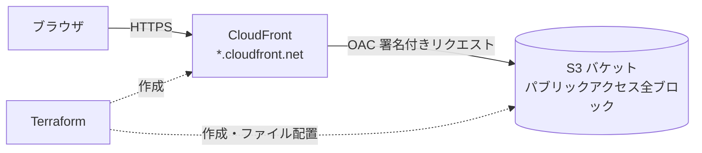

# Step 1：S3 + CloudFront で静的サイトを公開する

非公開の S3 バケットに置いた HTML を、CloudFront 経由で HTTPS 配信する構成を Terraform で構築します。

## 構成図



## ポイント

| 項目 | 内容 | 理由 |
|---|---|---|
| S3 は非公開 | パブリックアクセスブロックをすべて有効化 | S3 の静的ウェブサイトホスティングは使わず、直接アクセスを防ぐ |
| OAC | CloudFront だけが S3 を読める | 旧方式の OAI ではなく、現在推奨の OAC を使用 |
| HTTPS | CloudFront 標準証明書 | 独自ドメインなしなら Route 53・ACM が不要で無料 |
| キャッシュ | マネージドポリシー `CachingOptimized` | 静的ファイル向けの AWS 推奨設定 |
| タグ | `default_tags` で全リソースに Owner / Project を付与 | 共有アカウントで誰のリソースか分かるように |
| 削除 | `force_destroy = true` | `terraform destroy` でファイルごと消せる（学習用） |

## 前提

- Terraform 1.6 以上
- AWS CLI で認証済み（`aws sts get-caller-identity` が通ること）
- 必要な権限：S3、CloudFront（ディストリビューション・OAC）、IAM の読み取り

## 手順

```bash
cd step1-static-site

# 1. 変数ファイルを用意（Git には上がらない）
cp terraform.tfvars.example terraform.tfvars
#    owner を自分の名前に書き換える

# 2. 初期化 → 差分確認 → 作成
terraform init
terraform plan
terraform apply

# 3. 出力された site_url をブラウザで開く
#    ※ CloudFront の作成・反映に数分かかります
```

## ページを更新したとき

`site/` 配下を編集して `terraform apply` すると、変更されたファイルだけ再アップロードされます。
CloudFront のキャッシュが残っている場合は、キャッシュを削除します。

```bash
aws cloudfront create-invalidation \
  --distribution-id "$(terraform output -raw distribution_id)" \
  --paths "/*"
```

## 片付け

```bash
terraform destroy
```

## 費用の目安

学習用のアクセス量なら、CloudFront・S3 ともに無料枠内か月数円程度です。
時間課金のリソース（EC2、NAT ゲートウェイなど）は使っていません。

## やってみて分かったこと

<!-- 構築中に詰まった点や気づきをここに書くと、ポートフォリオとして価値が上がります -->
