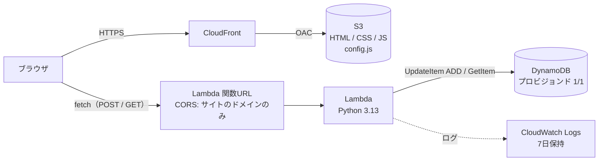

# Step 2：Lambda + DynamoDB で訪問者カウンターを作る

Step 1 の静的サイトに、サーバーレスの API を追加します。ページを開くと Lambda が呼ばれ、DynamoDB に保存したカウントを 1 増やして表示します。

## 構成図



## ファイル構成

| ファイル | 内容 |
|---|---|
| `site.tf` | S3 + CloudFront（Step 1 と同じ）と、API の URL を渡す `config.js` の生成 |
| `api.tf` | DynamoDB、Lambda、IAM ロール、ロググループ、関数URL |
| `lambda/app.py` | カウンターの処理（Python） |
| `site/app.js` | ブラウザから API を呼んで表示する処理 |

## 設計のポイント

| 項目 | 選択 | 理由 |
|---|---|---|
| API の入り口 | Lambda 関数URL | API Gateway より構成が簡単で、追加料金がかからない |
| CORS | サイトの CloudFront ドメインのみ許可 | 他のサイトのブラウザから呼ばれないように |
| DB | DynamoDB（プロビジョンド 1/1） | 常に無料枠に収まる。オンデマンドは無料枠の対象外 |
| カウント処理 | `UpdateItem` の `ADD` | 読み取り→加算→書き込みを 1 回で行うので、同時アクセスでも数がずれない |
| 権限 | テーブル 1 つとロググループ 1 つだけ | 最小権限の原則 |
| ログ | 保持期間 7 日 | 無期限に溜まって課金されるのを防ぐ |
| API の URL | Terraform が `config.js` を生成 | 作るまで決まらない値を、手作業なしでフロントに渡す |
| 二重カウント防止 | `sessionStorage` | 同じタブでの再読み込みは数えない |

## 手順

```bash
cd step2-visitor-counter

cp terraform.tfvars.example terraform.tfvars
#   owner を自分の名前に書き換える

terraform init
terraform plan     # Plan: 19 to add になる想定
terraform apply
```

出力された `site_url` を開いて、カウンターが表示されれば成功です。

### API を直接たたいてみる

```bash
API=$(terraform output -raw counter_api_url)

curl -s "$API"              # 今の値（増えない）
curl -s -X POST "$API"      # +1 される
```

### ログを見る

```bash
aws logs tail "/aws/lambda/handson-visitor-counter-counter" --follow
```

## 片付け

```bash
terraform destroy
```

## 既知の制約と改善案

- 関数URLは公開されているので、`curl` などで直接呼べばカウントを増やせてしまう（CORS はブラウザにしか効かない）
  - 改善案：CloudFront の背後に置き OAC で保護する、AWS WAF でレート制限する
- 同じ人でも、新しいタブやブラウザで開けば再度カウントされる

## やってみて分かったこと

<!-- 構築中に詰まった点や気づきをここに書く -->
